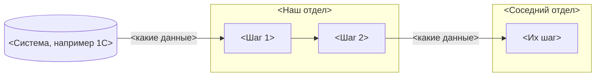

# Шаблон BUSINESS-ARCHITECTURE.md

Файл для разработчика. По нему он должен понять работу отдела без звонка человеку:
какой процесс закрывает программа, с кем этот процесс связан, какие данные в нём
живут и откуда они приходят. Потом по этому файлу данные отдела переносят в общее
хранилище компании (боевой DWH).

Правила заполнения:

- Источники: `DESIGN.md`, `ARCHITECTURE.md`, `SECURITY.md`, `REVIEW.md`, `DEPLOY.md`,
  отчёт опросника, если он лежит в папке, и ответы человека в переписке.
- Не выдумывай. Чего человек не говорил — пиши «не указано». Не знает ответа на
  технический вопрос — «не знает, уточнить у <кого он назвал>».
- Отделы, процессы и системы называй так, как их назвал человек.
- Цифры (сколько раз, сколько часов, сколько записей) переноси точно, не досчитывай.
- Персональные данные клиентов, пароли и ключи в файл не попадают никогда.
- Обновляй файл, а не переписывай: прошлые версии в журнале остаются.

Ниже сам шаблон. Заголовки и порядок разделов не меняй, чтобы файлы всех отделов
складывались в одну карту.

````markdown
# Бизнес-архитектура: <название программы>

| | |
|---|---|
| **Отдел** | <отдел> |
| **Процесс** | <какой процесс закрывает программа, одной фразой> |
| **Версия** | <v0 (бета) / v0.N / v1.0> · <дата> |
| **Заполнял** | <должность> |
| **Адрес программы** | <ссылка или «пока локально»> |
| **Статус** | <бета / в работе у отдела / 1.0, готово к передаче разработчику> |

## 1. Зачем программа

- **Проблема:** <что мешало, словами человека>
- **Кто пользуется:** <роли и сколько человек>
- **Успех:** <цифра, по которой поймём, что стало лучше>

## 2. Процесс по шагам

| № | Шаг | Кто делает | Получает на входе | Отдаёт дальше | Где сейчас | Как часто | Что делает программа |
|---|---|---|---|---|---|---|---|
| 1 | | | | | 1С / Excel / мессенджер / бумага | | |

**Ручные шаги и потери времени:** <какие шаги делаются руками, сколько времени, со слов человека>
**Где ошибки и задержки:** <где теряется, путается, ждёт>

## 3. Как процессы связаны

Схема: процессы отдела, соседние отделы и системы. Стрелка = передача данных,
подпись на стрелке = какие данные.



## 4. Стыки с другими отделами

| Откуда → куда | Какие данные | Как передаётся сейчас | Как часто | Что не так на стыке |
|---|---|---|---|---|

## 5. Данные (модель для разработчика)

| Сущность | Поля и типы | Ключ для связи | Источник | Кто вносит | Как часто обновляется | В программе хранится как |
|---|---|---|---|---|---|---|
| <Клиент> | <название: текст, город: текст, …> | <код клиента в 1С> | <1С> | <менеджер> | <ежедневно> | <Firestore: clients> |

Ключ для связи обязателен у всего, что пришло из другой системы: по нему разработчик
склеит данные разных отделов в одном хранилище.

## 6. Системы-источники

| Система | Что из неё берём | Как сейчас: руками, файлом, по API | Кто знает детали |
|---|---|---|---|

## 7. Доступы

| Роль | Что видит | Что меняет |
|---|---|---|

## 8. Что уходит в общее хранилище (DWH)

- **Сущности и цифры, нужные другим отделам и руководителю:** <список>
- **Главный источник для каждой сущности** (чьи цифры верные, если расходятся): <список>
- **Возможные дубли и расхождения:** <например, один клиент в 1С и в CRM под разными названиями>

## 9. Журнал версий

| Версия | Дата | Что изменилось | Кто пробовал | Адрес |
|---|---|---|---|---|
| v0 (бета) | | Первая версия | | |

## 10. Открытые вопросы для разработчика

- <что не решено, что проверить, у кого уточнить>
````

## Версии

- **v0 (бета)** — первая сборка через `/airl-start`.
- **v0.1, v0.2 …** — каждое обновление по отзывам коллег. Одна строка в журнале на
  каждое обновление.
- **v1.0** — ставится, только когда выполнено всё:
  1. процесс из раздела 2 целиком проходит в программе;
  2. программу пробовали хотя бы 2–3 коллеги, их замечания закрыты или записаны;
  3. в `SECURITY.md` и `REVIEW.md` нет красных находок;
  4. раздел 5 заполнен: у каждой сущности есть источник и ключ для связи.
- **После 1.0** файл вместе с адресом программы передают разработчику. Он переносит
  данные в боевое хранилище компании и связывает программы отделов между собой.
